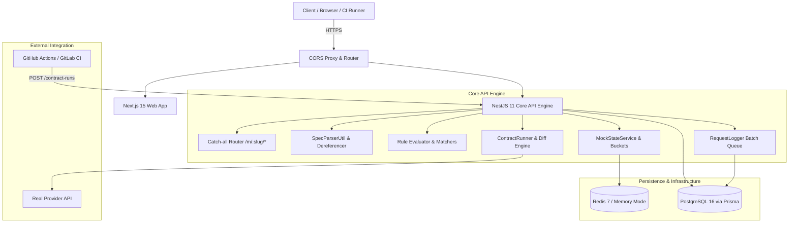

# MockLab Architecture & System Design

MockLab is a developer-first API mocking and contract-testing platform. It bridges the gap between OpenAPI specifications, fast local UI prototyping, and automated contract drift assertion in CI pipelines.

---

## 1. Monorepo Organization

MockLab is structured as an optimized pnpm monorepo:

| Package | Role | Technologies |
|---|---|---|
| `apps/web` | Next.js 15 App Router frontend (24 Stitch screens) | React 19, Tailwind v4, Lucide icons, `next-themes` |
| `apps/api` | High-throughput mock router & contract engine | NestJS 11, Prisma ORM, Express, BullMQ, ioredis |
| `packages/shared` | Cross-boundary schemas, types, and tokens | TypeScript 5.8, Zod, design system tokens |

---

## 2. Core Subsystems

### 2.1 Catch-All Mock Router (`/m/:slug/*`)
- **Route Matching**: Dynamically captures inbound paths against OpenAPI path templates (e.g. `/pets/{id}` or `/orders/:id`).
- **Priority Evaluation**: Active rules are sorted by ascending priority (`priority: 1` evaluated first). First rule matching all defined clauses (method, query params, headers, JSONPath body) wins.
- **Near-Miss Diagnostics**: When no rule matches, calculates candidate proximity scores across registered endpoints and returns an actionable `404 Not Found` report identifying exact missed criteria.
- **Latency & Fault Simulation**: Injects configurable artificial delays (0–5000ms) and faults (`malformed-json`, `empty-body`, `connection-reset`).

### 2.2 Stateful Scenarios & Bucket Isolation
- **Resource Buckets**: Stores dynamic collection entities (`mock:{projectId}:{scenarioKey}:bucket:{resource}`).
- **Dual-Engine Architecture**: Operates on high-speed TCP Redis with transparent in-memory fallback for local sandboxes or offline development.
- **ID Substitution**: Inbound payloads with `id: "new"` automatically receive cryptographically secure UUIDs.
- **Isolation by Key**: Teams isolate test state by passing `X-MockLab-Scenario: test-run-42` without cross-polluting concurrent test suites.

### 2.3 Contract Testing & Deep Structural Diff
- **Recursive Structural Diff**: Compares JSON mock expectations against live provider responses across status codes, headers, and payloads.
- **Verdict Taxonomy**:
  - `PASS`: Exact structural and type compatibility.
  - `BREAKING`: Removed keys, altered primitives (e.g. `string` -> `number`), or unexpected 4xx/5xx status codes.
  - `NON_BREAKING`: New additive keys present in live response not yet in mock.
  - `ERROR`: Network failure, timeout, or DNS resolution failure.
- **Decryption**: AES-256-GCM decrypted credentials supply live bearer tokens or API keys to real providers securely.

### 2.4 Traffic Inspector Batch Queue
- **Non-blocking Ingestion**: High-throughput mock hits are enqueued in-memory and flushed to database in batches (up to 500 rows or every 5 seconds), maintaining sub-millisecond mock response latencies.
- **Automated PII & Auth Redaction**: Strip sensitive headers (`Authorization`, `Cookie`, `X-MockLab-Key`) before persistence.
- **Scale Capping**: Payloads exceeding 100 KB are safely truncated with warning markers.
- **1-Click Rule Creation**: "Create rule from request" transforms any inspected 404 Near-Miss into a working mock rule with prefilled schema and matchers.

### 2.5 Security, RBAC & API Keys
- **API Key Format**: Stripe-style `mk_live_...` or `mk_test_...` tokens. Plaintext tokens shown only once at creation; stored strictly as SHA-256 hashes.
- **Sliding-Window Rate Limiting**: 60-second sliding windows enforcing configured requests/min. Rejections return HTTP `429 Too Many Requests` with standard `Retry-After` header.
- **Workspace RBAC**:
  - `OWNER`: Full administrative authority, billing management, and workspace deletion.
  - `ADMIN`: Team management, settings configuration, and API key generation.
  - `EDITOR`: Mock creation, rule editing, and contract test execution.
  - `VIEWER`: Read-only inspection of mocks, logs, and runs.
